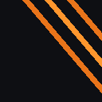

<p align="center">
  <h1 align="center">RAWR</h1>
  <strong>Local &bull; Free &bull; Offline</strong><br/>
  Unified game wrapper removal - one binary, no dependencies, no GUI.
</p>

<p align="center">
  
</p>

---

**Jump to:** [What it does](#what-it-does) · [Why](#why) · [Install](#install) · [Usage](#usage) · [How it works](#how-it-works) · [Safety](#safety) · [Roadmap](#roadmap) · [Building](#building) · [License](#license)

---

RAWR removes the distribution wrapper that old download-service games were
shipped inside, so the original game program is what you end up running.

It is a single static binary, it works completely offline, and it never
touches a file it does not own.

```bash
rawr "/games/Cannon Blast" "/games/Diamond Drop"
```

---

## What it does

RAWR looks at an installed game folder, works out whether the game is still
wrapped, and if it is, replaces the wrapper with the original game program
and removes the wrapper's leftovers.

For the **Reflexive Arcade** service (the wrapper that GameHouse, BigFish,
Alawar and a dozen other publishers used between roughly 2003 and 2009) the
wrapper consists of:

| Piece | What it is |
|---|---|
| `<Game>.exe` | a small launcher stub, not the game |
| `<Game>.RWG` | the real game program, encrypted |
| `ReflexiveArcade/ReflexiveArcade.dll` | the trial timer and registration module |
| `ReflexiveArcade/RAW_002.wdt` | the encrypted configuration blob |
| `ReflexiveArcade/*.wdt`, `*.jpg`, `Arcade.dat` | packaging leftovers |

RAWR decrypts the payload, writes the original program back over the stub,
carries the icon and the manifest across, and deletes the rest. The game
code itself is never patched.

It also handles the layouts that the popular community tooling does not:

- the **`.FFF` wrapper generation**, where the Reflexive glue code was moved
  out of `.text` into its own section - the seed derivation has to skip that
  section or the configuration never decrypts
- the **older builds** that shipped the payload as `RAW_001.dat` instead of a
  `.RWG` container
- packages where the support files sit **next to the game** instead of
  inside the `ReflexiveArcade` folder
- support files whose **case differs** between installs (`Background.jpg`
  vs `background.jpg`)
- games whose payload lives in a **subfolder** (`bin/`) with its own support
  directory

## Why

That download service is gone. The wrappers it left behind are not a
protection mechanism any more - they are dead infrastructure that stops old
games from running on a modern system, and they are the single most common
reason a preserved game "does not work".

A lot of people who want to play an old game run into exactly this wall:
the game is there, the assets are there, and the executable insists on
talking to a library that is either missing or a trial timer. RAWR removes
that wall.

RAWR is **not** a cracking tool. It does not generate registration keys,
does not patch the game's own code, and does not touch games that are still
being sold. It removes a distribution wrapper that no longer has a service
behind it.

## Install

Download the release for your platform and put it anywhere on your path.

The binaries are statically linked: the Linux build has no runtime
dependencies at all, the Windows build uses the static MSVC runtime. There is
nothing to install and nothing to uninstall.

## Usage

```
rawr <folder> [<folder> ...]        remove the wrapper from every given game folder
rawr deps-check                    report the build dependencies and their status
rawr deps-install                  install the missing build dependencies
rawr selftest                      run the built in checks
rawr version                       print the version
rawr help                          print the usage
```

| Option | Meaning |
|---|---|
| `-n`, `--dry-run` | show what would happen, change nothing |
| `-v`, `--verbose` | report every step, including the seed derivation |
| `-q`, `--quiet` | only report failures |
| `--no-resources` | do not carry the icon and manifest over |
| `--keep-temp` | keep the stage folder instead of deleting it |
| `--json` | print the result as JSON, for scripts |

### Examples

```bash
# see what would happen, change nothing
rawr --dry-run ~/games/Cannon\ Blast

# unwrap a whole library
rawr ~/games/*/

# machine readable, for a batch script
rawr --json ~/games/Cannon\ Blast | jq '.results[0].status'

# verify the binary itself
rawr selftest
```

### Output

```
$ rawr "Cannon Blast"
RAWR 0.0.0 - unified game wrapper removal

  [+] Cannon Blast: wrapper removed -> Cannon Blast/CannonBlast.exe
      seed method: original_crc32_sections_and_sizes
      restored 27 resources (icon, manifest, version info)
```

Folders that are not wrapped are reported as `already-clean` and left alone.
Folders RAWR cannot handle are reported with the reason and are also left
alone.

## How it works

The Reflexive wrapper protects the game with a small stream cipher whose
keystream comes from a 250 word state array, seeded with a value derived
from the packaged files themselves.

RAWR reproduces that maths exactly, in a few hundred lines of C++ with no
dependencies at all:

1. **Find the layout.** The support folder, the configuration blob, the
   payload and the launcher stub, wherever they happen to live.
2. **Derive the seed.** The wrapper computed a CRC32 over the launcher's
   section bytes, the `RAW_003` section bytes and the sizes of the four
   support images. RAWR reproduces that, and falls back to a full file CRC
   and then to a search over file size combinations when a package was
   repacked.
3. **Decrypt the configuration** and read the flags that describe how the
   payload was encrypted.
4. **Locate the encrypted region** in the payload: the part of the entry
   point's section that the wrapper scrambled.
5. **Decrypt the payload** with the second seed and check that the result
   really is a program.
6. **Carry the resources over.** The icon, the application manifest and the
   version information live in the launcher stub, not in the game. Without
   this step the recovered game shows a blank default icon.
7. **Write it out atomically** and remove the wrapper's leftovers.

Nothing about the game's own code is modified. The program you get back is
the program's original bytes.

## Safety

RAWR is built to be boring about your files.

- **It only touches what it understands.** A folder that is not a wrapped
  game is reported and left alone.
- **It is idempotent.** Running it twice is harmless; the second run finds
  nothing to do.
- **It stages before it writes.** The files that are about to change are
  copied into a hidden `.rawr-stage-<signature>` folder first. If the tool
  is killed half way through, the next run finds the stage folder, restores
  the originals and starts clean.
- **It writes atomically.** Every file is written to a temporary name and
  renamed into place, so an interrupted write never leaves a half written
  executable behind.
- **It refuses to guess.** If the decrypted payload does not look like a
  program, the folder is left exactly as it was and the reason is printed.
- **It is offline.** No network access, no telemetry, no registry writes.

## Roadmap

See [ROADMAP.md](ROADMAP.md) for the full list. The short version:

- integrated wrappers, where the binding layer is compiled into the game
- the other download services: GameTop, GameHouse, MyPlayCity, MyRealGames
- the Steam depots that were pulled from the store

## Building

RAWR needs a C++17 compiler and CMake. Nothing else - there are no third
party libraries.

```bash
cmake -S . -B build -DCMAKE_BUILD_TYPE=Release
cmake --build build -j
./build/rawr selftest
```

Or, if you do not have the toolchain yet:

```bash
rawr deps-check      # reports what is missing
rawr deps-install    # installs it (apt-get / winget / choco)
```

The Linux build is fully static. The Windows build uses the static MSVC
runtime (`/MT`) so the released binary has no DLL dependencies.

## License

MIT. See [LICENSE](LICENSE).
